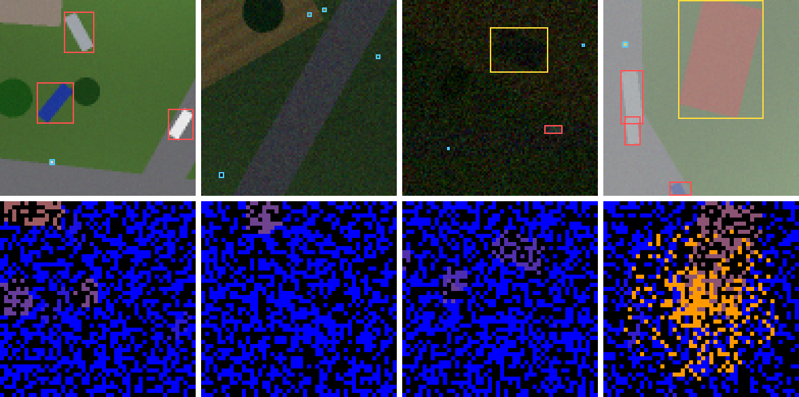
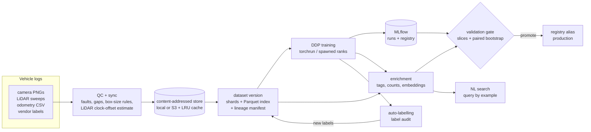

# UxV ML Platform

An end-to-end ML platform for multimodal drone (UxV) sensor data: raw flight
logs in, a validated and promoted perception model out. It covers the parts of
the ML lifecycle that a platform team owns: ingestion and quality checks,
cross-sensor time sync, versioned and sharded datasets, high-throughput
loading, distributed and reproducible training, experiment tracking and a model
registry, slice-level validation gates, and AI tooling for the data itself
(auto-labelling, label-error detection, metadata enrichment and dataset
search). Every step is a CLI command that runs locally, in CI, and as an
Argo Workflow on Kubernetes.

All numbers below were measured in this repository on 2 CPU cores, on
**synthetic** flights from the built-in simulator (see [Scope](#scope-and-limitations)).
The simulator keeps a hidden ground-truth file per flight, which is what makes
the QC, sync, auto-labelling and search components measurable at all.



*Top: nadir camera frames (day, dusk, night, fog) with annotations (red vehicle,
cyan person, yellow building). Bottom: the LiDAR sweep for the same instant,
motion-compensated with odometry and projected into the camera grid
(blue = ground return, purple→orange = taller structures).*

## Results at a glance

Full numbers, method and caveats: [docs/RESULTS.md](docs/RESULTS.md).

| Area | Result |
|---|---|
| Ingestion QC | 65/65 dead or saturated frames and 4/4 LiDAR outages caught, no false alarms; size rule caught 67% of wrong-class labels at 100% precision |
| Time sync | 3 of 9 injected LiDAR clock offsets corrected to within 14 ms, **0 wrong corrections**; low-contrast flights flagged instead of guessed |
| Reproducibility | same flights ⇒ same dataset version id; two DDP training runs ⇒ **bit-identical weights** |
| Loading | 3,676 samples/s from shards vs. 83 samples/s decoding raw logs (single process) |
| Camera + LiDAR fusion | test mAP 0.673 vs. 0.622 camera-only (+0.050, 95% CI +0.029…+0.070); night 0.552 vs. 0.385 |
| Validation gate | blocks camera-only vs. fusion on 7 checks (night, heavy fog, vehicle, person…); passes an identical rerun with Δ = 0 |
| Label audit | finds 87% of shifted boxes and 66% of wrong classes in a noisy annotation batch; flags are 2.5× richer in errors than random review |
| Metadata + search | lighting tags 88% and fog tags 79% accurate on unseen flights; NL query precision 33–92% depending on query |
| Auto-labelling | 22% of unlabelled frames auto-accepted at 98% box precision but only 35% recall (confident misses slip through); the model trained with them recovers 77% of the gap to full human labels |


## Architecture



| Step | Command | What it does |
|---|---|---|
| simulate | `uxvml simulate` | Generates survey flights with realistic defects (clock offsets, dropped sweeps, dead frames, noisy annotation batches). |
| ingest | `uxvml ingest` | QC, LiDAR/camera sync and fusion rasters, sharding, Parquet index, dataset manifest. Same inputs ⇒ same version id. |
| train | `uxvml train` | PyTorch DDP (Gloo on CPU, NCCL on GPU), seeded and deterministic; logs dataset version, code version and a weights hash to MLflow; registers the model. |
| enrich | `uxvml enrich` | Lighting/fog tags, LiDAR features, predicted object counts and an embedding per frame. |
| validate | `uxvml validate` | Per-slice metrics vs. production with paired-bootstrap CIs; promotes via the registry alias only if every check passes. |
| search | `uxvml search "night frames with at least 3 vehicles"` | Text → validated structured query → frames. `--llm` uses a Claude model instead of the offline parser. |
| similar | `uxvml similar <sample_id>` | Nearest frames by embedding, excluding the query's own flight. |
| lineage | `uxvml lineage --model ...` | Model → MLflow run → dataset version → shards → raw flight hashes. |
| pipeline | `uxvml pipeline` | Runs the whole DAG locally with content-keyed step caching. |

## Quick start

```bash
pip install --index-url https://download.pytorch.org/whl/cpu torch
pip install -e ".[dev]"
pytest -q                                              # unit + integration tests
uxvml pipeline --config configs/pipeline-smoke.yaml    # full DAG on a tiny dataset (~3 min)
uxvml pipeline --config configs/pipeline-smoke.yaml    # again: every step is a cache hit
uxvml search "dark frames with at least 1 vehicle" --store work-smoke/store
```

The full benchmark (36 flights, 5,695 frames) is `configs/pipeline.yaml`; the
experiments in [docs/RESULTS.md](docs/RESULTS.md) are reproduced with
`scripts/train_runs.py`, `scripts/autolabel_experiment.py` and
`scripts/benchmarks.py`.

### On Kubernetes

```bash
kind create cluster --name uxv
kubectl create ns argo && kubectl apply -n argo -f https://github.com/argoproj/argo-workflows/releases/download/v3.6.10/install.yaml
docker build -t uxvml:dev . && kind load docker-image uxvml:dev --name uxv
kubectl apply -k deploy/k8s/overlays/kind
argo submit -n uxv --from workflowtemplate/uxv-perception --wait --log
```

`deploy/k8s/overlays/gpu` patches the same template for a GPU cluster: the
train step requests `nvidia.com/gpu`, runs one torchrun rank per GPU, selects
GPU nodes and tolerates their taint. CI renders and lints both overlays and
runs the kind overlay end to end.

## Design notes

**Dataset versions are content hashes.** A version id is a hash of the raw
input hashes, the ingestion parameters, the ingestion code version and the
resulting shard digests. There are no timestamps in shards or manifests, so
re-ingesting the same flights reproduces the same id, and any change (one new
flight, one parameter) yields a new one with a `parent` pointer. Objects are
verified against their hash on every read.

**Shards, not files.** Samples are packed into ~9 MB shards with a tiny
deterministic binary format (`UXS1`: JSON header + raw arrays, zero-copy
reads). Shards are the unit of distribution: each DDP rank and dataloader
worker gets a disjoint set per epoch, and a shuffle buffer mixes samples
across shards. Remote stores sit behind a size-capped local LRU cache.

**Sync is estimated, and only trusted when the data supports it.** LiDAR
points are motion-compensated with odometry and projected into the camera.
A LiDAR clock offset makes structures land in the wrong place, so ingestion
searches for the offset that best aligns LiDAR height edges with image edges.
Night and fog frames give a flat alignment curve; those flights are marked
`unverified` instead of being "corrected" with a guess.

**The gate compares against noise, per slice.** A candidate is blocked if it is
below an absolute floor, if its lineage is incomplete, or if any metric
(overall, per class, per lighting / fog / altitude slice) drops by more than
its tolerance *and* the 95% paired-bootstrap interval of the difference lies
below zero. Identical models pass with a delta of exactly 0.

**Evaluation data is protected.** Splits are by flight (no frame leakage).
Only flights from the trusted annotation vendor can land in val/test,
stratified by lighting so every condition is represented.

**Auto-labels must earn their place.** Per-class thresholds are calibrated on
val for 95% precision. A frame is auto-labelled only if every detection is
clearly above or clearly below its threshold; anything borderline goes to a
human review queue.

## Scope and limitations

- **Synthetic data.** Flights come from a procedural simulator, not real
  sensors (no real UxV datasets were available in the build environment).
  Imagery is 96×96 and LiDAR is a deskewed single-return model. The value is
  in the platform mechanics and in being able to score them against truth;
  absolute model accuracy says little about real perception.
- **CPU only.** All training here ran on 2 CPU cores with Gloo. The NCCL/GPU
  path (`overlays/gpu`, CUDA device selection) is written but has not been run
  on GPUs.
- **Storage.** Benchmarks used the local store; the S3 backend and its cache
  are tested against mocked S3 (moto), not a live bucket.
- **Sync estimator recall is limited** in low-contrast conditions (see
  results). Fog backscatter returns are not filtered from LiDAR yet; they show
  up as spurious tall points in foggy rasters.
- **LLM query parser** is tested with a mocked client only (no API key in CI).

## Repository layout

```
uxvml/sim        procedural world, flight trajectories, sensors, injected defects
uxvml/data       raw log reader, QC, sync/fusion, object store, shard format, dataset builder, loader
uxvml/train      detector, targets/loss/metrics, DDP trainer with MLflow
uxvml/validate   slice metrics, paired bootstrap gate, promotion
uxvml/curate     enrichment, search, auto-labelling, label audit
uxvml/pipeline   cached local DAG runner
deploy/k8s       kustomize base (Argo WorkflowTemplate, RBAC, PVC) + kind and GPU overlays
scripts          benchmark and experiment drivers
```
